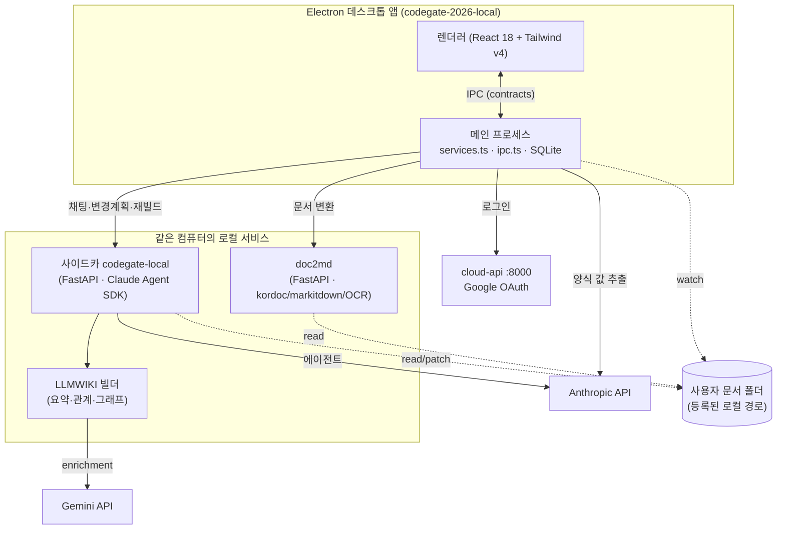

# Folding — 제품 레퍼런스

이 스킬은 **이 코드베이스에서 무언가를 만들기 전에 읽는 지도**다. 값이 어디서 오고, 왜
그렇게 되어 있고, 어디를 고쳐야 하는지를 담는다.

## 이 제품이 무엇인가

**Folding 은 사용자의 로컬 문서를 읽고, 근거를 붙여 답하고, 문서를 고쳐 주는 데스크톱
에이전트다.** 클라우드에 문서를 올리지 않는다 — 위키도 색인도 이 컴퓨터에만 있다.

핵심 약속 세 가지:

1. **모든 답에 원문 근거가 붙는다.** 인용을 누르면 실제 파일이 열린다. 근거를 못 찾으면
   지어내지 않고 "확인되지 않음"이라고 답한다.
2. **문서를 고칠 때는 반드시 승인을 받는다.** 무엇이 어떻게 바뀌는지 보여준 뒤에만 쓴다.
   원본은 `.bak` 으로 백업된다.
3. **한글(HWP/HWPX)을 서식 그대로 다룬다.** LibreOffice 변환을 거치지 않는다 — 그 경로는
   표·서식이 무너져 품질이 낮다. `kordoc` 으로 파싱·패치해 원본 서식을 보존한다.

에이전트 자체는 **범용**이다(Claude Code·Codex 처럼 컴퓨터 작업 전반). 문서 작업에만
한정된 도구가 아니라, 문서 작업을 **우리가 지정한 고품질 경로로 유도**하는 구조다.
이 구분이 설계를 읽을 때 가장 중요하다 — 제약이 있는 곳은 대개 "범위를 좁히려고"가 아니라
"품질을 지키려고" 있다.

## 핵심 아키텍처

**저장소 넷이 한 제품을 이룬다:**

| 저장소 | 역할 | 언어 |
|---|---|---|
| `codegate-2026-local` | 데스크톱 앱(렌더러+메인), 계약, 오케스트레이션 | TypeScript |
| `codegate-2026-agent` | 사이드카 — 에이전트·변경계획·위키 어댑터 | Python |
| `codegate-2026-convert` | doc2md — 문서→마크다운 변환 | Python |
| `LLMWIKI` | 위키 빌더 + cloud-api(OAuth) | Python |

## 자세한 레퍼런스

필요한 것만 열어 읽는다. 전부 읽을 필요는 없다.

| 파일 | 언제 읽나 |
|---|---|
| `references/architecture.md` | 데이터 흐름, 파이프라인, 계약 경계, 캐시 판 번호 규칙을 알아야 할 때 |
| `references/frontend.md` | 화면·컴포넌트·상태 훅·디자인 토큰을 다룰 때 |
| `references/backend.md` | 사이드카·doc2md·위키 빌드·에이전트 도구·승인 게이트를 다룰 때 |
| `references/conventions.md` | 코드를 쓰기 전에 — 오류 처리, 테스트, 커밋, 흔한 함정 |

`DESIGN.md`(저장소 루트)에는 색·타이포·간격 토큰과 그 근거가 있다. UI 를 만들면 먼저 본다.

## 작업 전 반드시 아는 것 세 가지

이 셋을 모르면 **고쳤는데 아무 일도 안 일어나는** 상황을 반복하게 된다. 실제로 이 프로젝트
에서 같은 함정을 다섯 번 만났다.

**① 캐시 키에 "무엇으로 만들었는지"가 들어가야 한다.**
파일 해시만으로 캐시를 키잉하면, 변환기·렌더러를 고쳐도 옛 결과가 영원히 나온다. 이 코드
베이스에는 판 번호를 키에 넣은 곳이 넷 있다 — `doc2md/app/cache.py` 의 `_PIPELINE_VERSION`,
`input-sync.ts` 의 `CONVERTER_GENERATION`, `llmwiki.py` 의 `COMPAT_RENDER_VERSION`,
그리고 enrichment 의 `prompt_version`. 출력이 달라지는 변경을 하면 해당 번호를 올린다.

**② 오류를 감쌀 때 원인을 버리지 않는다.**
이 제품의 오류는 사용자에게 한국어 문장으로 나가는데, 그 과정에서 진짜 이유(HTTP 상태,
제공자 메시지, 서브프로세스 stderr)가 사라지기 쉽다. `logError` 는 `cause` 사슬을 끝까지
찍는다. 새 오류 경로를 만들면 원인을 반드시 실어 보낸다.

**③ 느리거나 실패할 수 있는 일을 기동 임계 경로에 넣지 않는다.**
헬스 체크가 먼저 만료되어 서비스가 통째로 죽는다. enrichment(문서당 수 초)와 보조
서비스(cloud-api)를 각각 그렇게 죽여 봤다. 배경으로 돌리거나, 실패를 잡아 경고만 남긴다.

## 함께 쓰면 좋은 스킬

| 스킬 | 언제 |
|---|---|
| `frontend-design` / `ui-ux-pro-max` | 새 화면·컴포넌트의 시각 방향을 잡을 때 |
| `claude-api` | Anthropic SDK·모델·스트리밍·도구 사용을 건드릴 때 |
| `dataviz` | 지식 그래프나 사용량 차트를 손볼 때 |
| `artifact-design` | 결과를 공유 페이지로 만들 때 |
