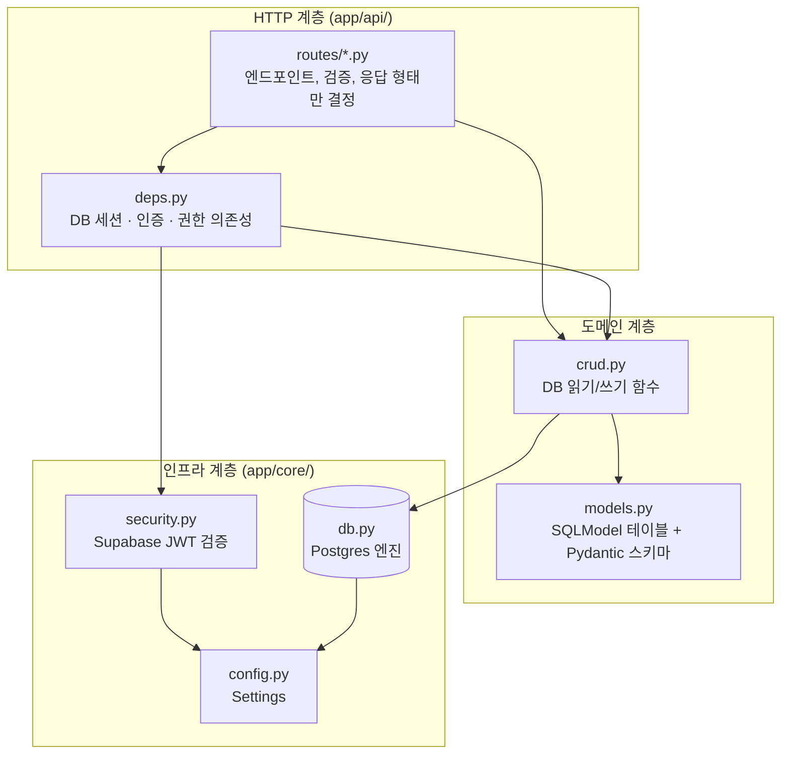
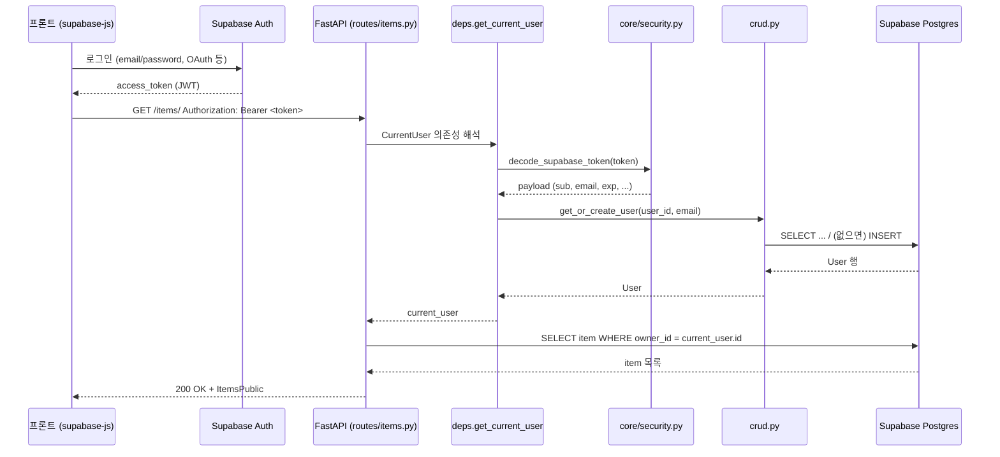
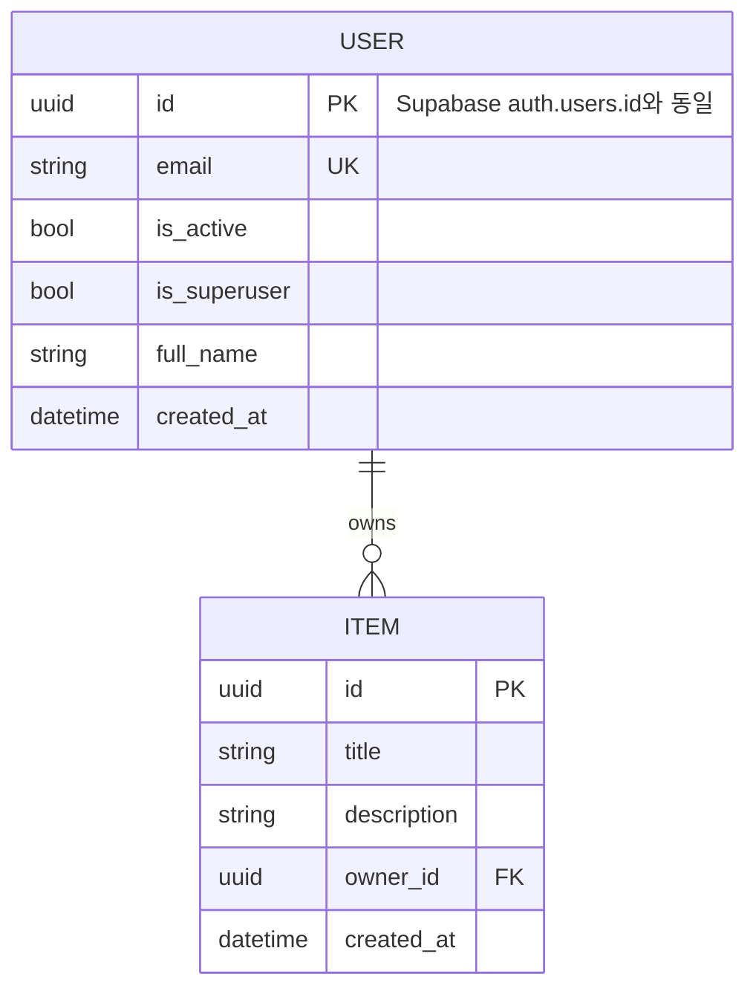

# 백엔드 구조 상세

`backend/` 실제 디렉토리 구조와 각 파일의 책임, 요청이 흐르는 경로, 데이터 모델을 정리한 문서. 전체 설계 원칙/MVP 순서는 [BACKEND_GUIDE.md](BACKEND_GUIDE.md) 참고.

## 1. 디렉토리 트리

```
backend/
├── app/
│   ├── main.py                  # FastAPI 앱 생성, CORS, Sentry, 라우터 등록 (진입점)
│   ├── crud.py                  # DB 접근 함수 모음 (Create/Read/Update — 라우트와 DB 사이 계층)
│   ├── models.py                # SQLModel: DB 테이블 + API 요청/응답 스키마
│   ├── utils.py                 # 이메일 발송 유틸 (테스트 메일만 현재 사용)
│   ├── backend_pre_start.py     # 컨테이너 기동 시 DB 응답 대기 (재시도 로직)
│   ├── tests_pre_start.py       # 테스트 실행 전 DB 응답 대기
│   │
│   ├── core/                    # 앱 전역 설정/인프라 — 도메인 로직 없음
│   │   ├── config.py            # Settings(pydantic-settings): .env → 타입 검증된 설정 객체
│   │   ├── security.py          # Supabase JWT 서명 검증 (토큰 발급은 안 함)
│   │   └── db.py                # SQLAlchemy/SQLModel 엔진 (Supabase Postgres, SSL)
│   │
│   ├── api/                     # HTTP 계층
│   │   ├── main.py              # 도메인별 라우터를 하나의 api_router로 합침
│   │   ├── deps.py              # 공용 의존성: DB 세션, 인증(get_current_user), 권한 체크
│   │   └── routes/
│   │       ├── users.py         # /users/* — 프로필 조회/수정/삭제, 관리자용 사용자 관리
│   │       ├── items.py         # /items/* — 샘플 도메인 리소스 (owner_id 기반 소유권 검증 예시)
│   │       ├── private.py       # /private/* — ENVIRONMENT=local에서만 mount, 로컬 시딩용
│   │       └── utils.py         # /utils/* — health-check, 테스트 메일 발송
│   │
│   ├── alembic/                 # DB 마이그레이션
│   │   ├── env.py               # Alembic이 SQLModel 메타데이터를 보도록 연결
│   │   └── versions/
│   │       └── 0001_initial_schema.py   # user, item 테이블 초기 스키마
│   │
│   └── email-templates/
│       ├── src/test_email.mjml  # 이메일 소스 (mjml → html 빌드)
│       └── build/test_email.html
│
├── tests/                       # app/ 구조를 그대로 미러링
│   ├── conftest.py              # 공용 fixture: db 세션, TestClient, 인증 헤더
│   ├── api/routes/               # 라우트별 통합 테스트 (test_users.py, test_items.py, test_private.py)
│   ├── crud/test_user.py        # crud.py 단위 테스트
│   ├── scripts/                 # backend_pre_start / tests_pre_start 테스트
│   └── utils/                   # 테스트 전용 헬퍼 (랜덤 데이터, 토큰 발급 등)
│
├── scripts/
│   ├── prestart.sh              # 컨테이너 기동 시: DB 대기 → alembic upgrade head
│   ├── lint.sh / format.sh      # ruff + mypy
│   └── test.sh / tests-start.sh # pytest 실행 (커버리지 포함)
│
├── Dockerfile
├── alembic.ini
├── pyproject.toml               # 의존성, ruff/mypy/bandit 설정
└── uv.lock
```

루트(`본선/`)에는 이 외에 `docker-compose.yml`(백엔드 컨테이너만, DB는 Supabase), `.env`/`.env.example`, `security/`(OWASP 레퍼런스)가 있다.

## 2. 레이어드 아키텍처



**의존 방향은 항상 위(HTTP)에서 아래(인프라)로만 흐른다.** `core/`는 `api/`나 `crud.py`를 절대 import하지 않는다 — 거꾸로면 순환 참조와 테스트 불가능한 결합이 생긴다. 도메인이 늘어나면 `crud.py`를 `crud/user.py`, `crud/item.py`처럼 쪼개되 이 방향 규칙은 유지한다.

## 3. 요청 처리 흐름 — 인증이 필요한 요청 예시

`GET /api/v1/items/` 요청이 처리되는 전체 경로:



핵심: **이 백엔드는 로그인 라우트가 없다.** 토큰은 항상 Supabase가 발급하고, 이 백엔드는 서명 검증(`SUPABASE_JWT_SECRET`)과 "이 사용자를 처음 보면 로컬 프로필 행을 만든다"는 auto-provisioning만 담당한다 (`app/crud.py:get_or_create_user`).

## 4. 데이터 모델



- `User.id`는 로컬에서 생성하지 않는다 — 항상 검증된 Supabase JWT의 `sub` 클레임에서 온다.
- `Item`은 실제 도메인 엔티티가 아니라 "소유권 검증이 있는 리소스"를 만드는 법을 보여주는 샘플이다. 실제 서비스 도메인(예: 채팅 세션, 문서, 결제)을 추가할 때 이 패턴(`owner_id` FK + `ondelete="CASCADE"` + 라우트에서 `current_user.id`와 비교)을 그대로 따라간다.

## 5. 파일별 책임 요약

| 파일 | 계층 | 책임 | 하면 안 되는 것 |
|---|---|---|---|
| `main.py` | 진입점 | 앱 인스턴스 생성, 미들웨어, 라우터 등록 | 비즈니스 로직 작성 |
| `api/main.py` | HTTP | 도메인 라우터 취합 | 엔드포인트 직접 정의 |
| `api/deps.py` | HTTP | 인증/세션/권한 등 공용 `Depends` | DB 쿼리를 직접 작성(→ crud 호출) |
| `api/routes/*.py` | HTTP | 요청 검증, crud 호출, 응답 스키마 변환 | SQL/ORM 쿼리 직접 작성(→ crud 사용), 비즈니스 규칙 누적 |
| `crud.py` | 도메인 | DB 읽기/쓰기, 트랜잭션 경계 | HTTP 예외(HTTPException) 발생 — 대신 `None`/`False` 리턴하고 라우트에서 판단 |
| `models.py` | 도메인 | 테이블 정의 + `XCreate`/`XPublic`/`XUpdate` 스키마 | 함수/로직 포함 |
| `core/config.py` | 인프라 | 환경변수 → `Settings` | 하드코딩된 값 (전부 `.env` 경유) |
| `core/security.py` | 인프라 | Supabase JWT 검증 | 비밀번호 처리(Supabase 책임) |
| `core/db.py` | 인프라 | SQLAlchemy 엔진 | 세션 생성(→ `api/deps.py:get_db`가 담당) |

## 6. 새 도메인을 추가할 때 손대는 파일 (체크리스트)

예: "채팅 세션" 도메인을 추가한다면 —

1. `app/models.py`에 `ChatSession`(테이블) + `ChatSessionCreate`/`ChatSessionPublic` 스키마 추가. 도메인이 3개 넘게 늘면 `app/models/chat.py`로 분리하고 `app/models/__init__.py`에서 재노출.
2. `uv run alembic revision --autogenerate -m "add chat session"` → `uv run alembic upgrade head`.
3. `app/crud.py`에 `create_chat_session`, `get_chat_session` 등 추가 (또는 `app/crud/chat.py`).
4. `app/api/routes/chat.py` 신규 — `CurrentUser`/`SessionDep` 의존성 재사용, 소유권 검증은 `items.py` 패턴 그대로.
5. `app/api/main.py`에 `api_router.include_router(chat.router)` 한 줄 추가.
6. AI 호출이 필요하면 `app/services/llm.py`(신규) 분리 — 라우트가 LLM SDK를 직접 호출하지 않기 (BACKEND_GUIDE.md 4장).
7. `tests/api/routes/test_chat.py` 추가, 기존 `test_items.py`를 템플릿으로 복사해서 변형.

## 7. 관련 문서

- [BACKEND_GUIDE.md](BACKEND_GUIDE.md) — 설치 내역, 설계 원칙, AI 특화 설계, OWASP 체크리스트, MVP 순서, Supabase 통합 가이드
- `backend/README.md` — 템플릿 원본 문서(uv/스크립트 사용법)
- `security/Index.md` — OWASP 체크리스트 전체 인덱스
