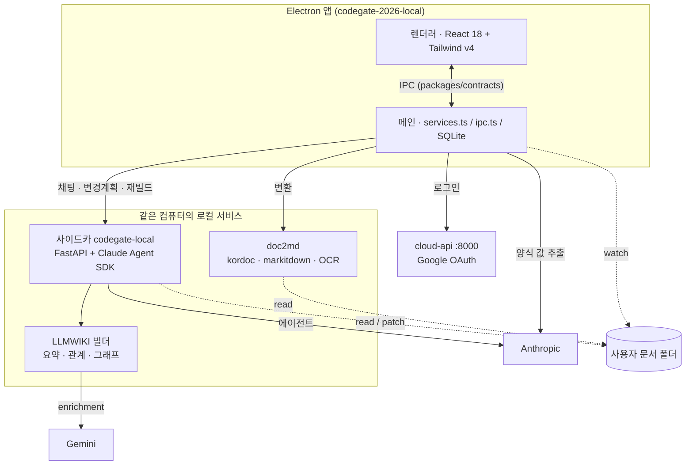

# Folding

**사용자의 로컬 문서를 읽고, 근거를 붙여 답하고, 문서를 고쳐 주는 데스크톱 에이전트.**
문서를 클라우드에 올리지 않는다 — 위키도 색인도 이 컴퓨터에만 있다.

약속 세 가지:

1. **모든 답에 원문 근거가 붙는다.** 인용을 누르면 실제 파일이 열린다. 근거가 없으면
   지어내지 않고 "확인되지 않음"이라고 답한다.
2. **문서를 고칠 때는 승인을 받는다.** 무엇이 어떻게 바뀌는지 보여준 뒤에만 쓰고,
   원본은 `.bak` 으로 백업한다.
3. **한글(HWP/HWPX)을 서식 그대로 다룬다.** LibreOffice 변환을 거치지 않는다 — 그 경로는
   표·서식이 무너진다. `kordoc` 으로 파싱·패치해 서식을 보존한다.

에이전트 자체는 **범용**이다(Claude Code·Codex 처럼). 문서 작업만 하는 도구가 아니라,
문서 작업을 **고품질 경로로 유도**하는 구조다. 코드에 제약이 있는 곳은 대개 범위를
좁히려는 게 아니라 품질을 지키려는 것이다.

## 아키텍처



저장소 넷이 한 제품을 이룬다: `codegate-2026-local`(앱·계약) · `codegate-2026-agent`
(사이드카) · `codegate-2026-convert`(doc2md) · `LLMWIKI`(위키 빌더 + OAuth).

## 시작

```bash
pnpm dev:integrated     # doc2md + cloud-api + 사이드카 + 앱
./node_modules/.bin/vitest run
./node_modules/.bin/tsc -p tsconfig.node.json --noEmit
```

## 스킬

| 스킬 | 언제 |
|---|---|
| **`folding-prd`** | **이 저장소에서 무언가를 만들기 전에 먼저 연다.** 아키텍처·기술스택·프론트 구성요소·규약·지뢰 목록 |
| `frontend-design` · `ui-ux-pro-max` | 새 화면·컴포넌트의 시각 방향 |
| `claude-api` | Anthropic SDK·모델·스트리밍·도구 사용 |
| `dataviz` | 지식 그래프·사용량 차트 |
| `artifact-design` | 결과를 공유 페이지로 |

디자인 토큰과 그 근거는 `DESIGN.md` 에 있다. UI 를 만들면 먼저 본다.
