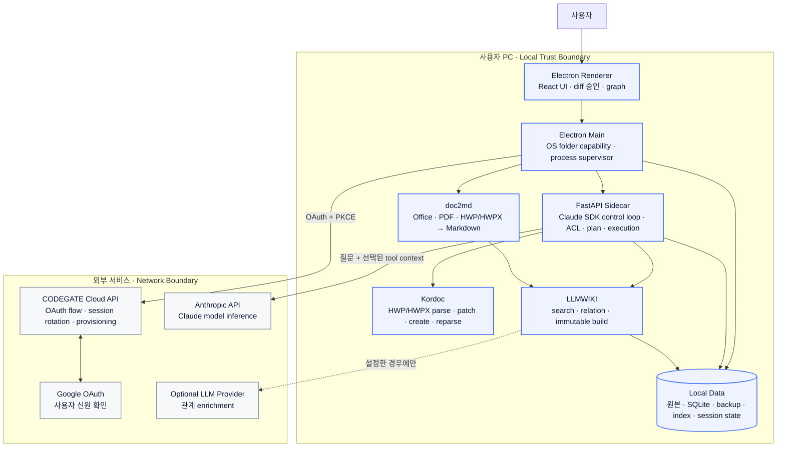
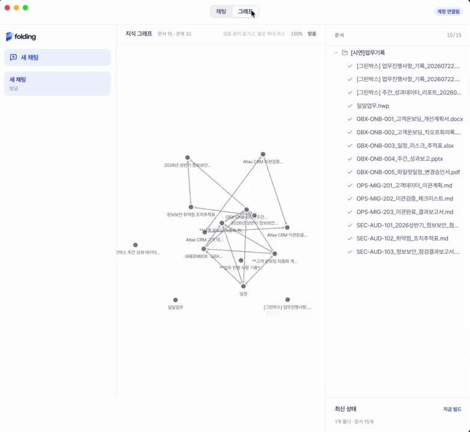
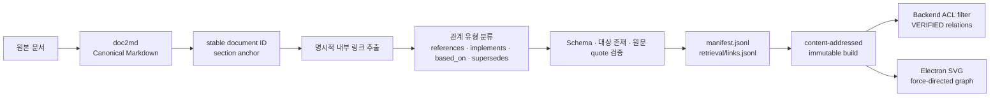
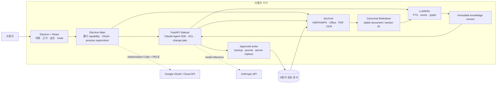

<p align="center">
  
</p>

<p align="center">
  로컬 업무 문서를 근거가 남는 지식으로 연결하고,<br>
  검색부터 승인형 변경·복구까지 이어 주는 데스크톱 문서 에이전트
</p>

<p align="center">
  <code>Electron · React · TypeScript</code>&nbsp;&nbsp;
  <code>FastAPI · Python</code>&nbsp;&nbsp;
  <code>Claude Agent SDK</code>&nbsp;&nbsp;
  <code>HWP/HWPX</code>
</p>

---

## Folding

업무 문서는 형식과 폴더가 제각각이고, 필요한 내용을 찾은 뒤 다시 문서에 반영하는 과정은
쉽게 끊깁니다. Folding은 사용자가 선택한 로컬 폴더를 정규화된 지식 버전으로 구성해 자연어로
탐색하고, 원문 근거를 확인하며, 지원되는 문서는 같은 대화 안에서 수정·삭제·생성할 수 있게 합니다.

에이전트의 판단과 파일시스템 권한은 분리되어 있습니다. 모델은 원본 파일을 직접 다루지 않으며,
모든 변경은 화면에 표시된 diff의 정확한 `plan_hash`를 사용자가 승인한 뒤 결정적인 실행 경로를
통해서만 적용됩니다.

## 시연


<p align="center">
  <a href="https://github.com/dotenv-uploaded/ghdtjdwn_complete/blob/main/docs/demo/folding-final-demo.mp4?raw=1">
    고화질 MP4로 보기
  </a>
</p>

시연에서는 로그인과 폴더 등록부터 문서 질의, 근거 확인, HWP 작성자 변경 승인, 여러 업무 문서를
바탕으로 한 주간업무보고서 HWPX 생성까지 하나의 흐름으로 확인할 수 있습니다.

## 어디서 실행되는가

Folding은 모든 기능을 서버로 보내는 웹 서비스도, 네트워크 없이 동작하는 완전한 오프라인 앱도
아닙니다. 파일 capability와 변경 책임은 사용자 기기에 두고, 계정 확인과 모델 추론만 외부
서비스를 사용하는 local-first hybrid 구조입니다.



### 사용자 PC에서 처리

| 구성요소 | 로컬에서 맡는 일 | 로컬에 남는 데이터 |
| --- | --- | --- |
| Electron Renderer | 대화, citation, 그래프, exact diff와 승인 UI | 화면 상태 |
| Electron Main | 폴더 선택 권한, 원본 scan, process supervision, OAuth callback | OS capability, 암호화된 CODEGATE session |
| FastAPI sidecar | Claude SDK 제어 루프, 검색, ACL, change plan, 실행 상태, retry·Undo | conversation state, execution journal, audit |
| doc2md | PDF·Office·HWP/HWPX를 canonical Markdown으로 변환 | 정규화 Markdown과 변환 cache |
| LLMWIKI | stable ID, chunk, relation, FTS·vector·graph와 불변 build 생성 | `current.json`, content-addressed builds, index |
| Kordoc writer | HWP/HWPX patch·생성 후 재파싱 검증 | 임시 candidate와 검증된 최종 원본 |
| File transaction | backup, journal, `fsync`, atomic replace와 복구 | 사용자 원본, immutable backup, SQLite |

로컬 sidecar는 이 구성의 control plane으로 동작합니다. Claude의 typed proposal을 현재 근거와
ACL로 다시 확인하고, `exact diff → plan_hash → 사용자 승인 → atomic write → 지식 버전 게시`를
하나의 실행 상태로 연결합니다. retry와 Undo도 같은 journal과 hash 규칙을 사용합니다.

이 구성요소는 loopback으로만 연결됩니다. Electron은 비어 있는 `127.0.0.1` 포트에서 sidecar를
시작하고 정확한 renderer origin만 CORS로 허용합니다. cloud session token은 sidecar process에
전달하지 않으며, child process에는 실행에 필요한 최소 환경변수만 넘깁니다.

### 외부 API와 서버에서 처리

| 외부 경계 | 처리하는 것 | 처리하지 않는 것 |
| --- | --- | --- |
| CODEGATE Cloud API | Google OAuth 시작·교환, PKCE 검증, CODEGATE access/refresh session 발급·회전, provisioning 확인 | 사용자 원본 문서, 로컬 검색, 문서 변경, backup, 지식 그래프 빌드 |
| Google OAuth | 계정 선택과 Google 신원 확인 | 로컬 폴더 권한과 문서 내용 |
| Anthropic API | 사용자 요청과 local tool context를 바탕으로 intent·target·구조화 제안 생성 | 실제 파일 write, diff 승인, ACL 판정, atomic replace, Undo |
| Optional enrichment provider | 명시적으로 설정한 경우 문서 관계 유형 후보 생성 | 근거 없는 신규 엣지 확정, active build 게시 |

Claude Agent SDK process와 tool 실행은 로컬이지만 모델 추론은 Anthropic API에서 수행됩니다.
따라서 사용자 질문, system instruction, 그리고 `knowledge_search`, `document_get`,
`knowledge_document_read`, `source_file_read`가 현재 요청에 맞춰 반환한 문서 텍스트는 모델
context로 전송될 수 있습니다. 반면 원본 파일 바이너리, 등록 폴더 전체, backup, SQLite, 로컬
index, 절대 파일 경로와 CODEGATE OAuth token은 이 추론 경로로 보내지 않습니다.

클라우드 로그인은 “누구인가”를 확인하고, OS 폴더 선택은 “어느 파일을 다룰 수 있는가”를
결정합니다. 로그인 성공만으로 로컬 파일 권한이 생기지 않으며, 로그아웃해도 원본이나 로컬 지식
버전을 삭제하지 않습니다.

## 프로젝트의 강점

| 강점 | 구현으로 확인되는 이유 |
| --- | --- |
| 로컬 파일에 맞춘 신뢰 경계 | 원본·변환·검색·write·backup을 사용자 PC에 두고 cloud identity, model inference와 분리했습니다. 서버에 로컬 filesystem capability를 위임하지 않습니다. |
| Prompt가 아닌 코드로 지키는 승인 | 모델에는 범용 파일 도구가 없습니다. ACL, base hash, exact `plan_hash`, 사용자 승인과 deterministic writer가 실제 변경 권한을 결정합니다. |
| 답변과 관계를 다시 추적할 수 있음 | canonical quote, stable document/section ID, revision과 graph version을 함께 반환합니다. 지식 그래프 엣지도 출발 section과 원문 quote를 가져야 합니다. |
| 실패해도 이전 정상 상태를 유지 | 원본 변경은 backup·journal·atomic replace로 복구하고, 지식 검색은 모든 index가 검증된 immutable build만 공개해 부분 version 노출을 막습니다. |
| 한국 업무 문서의 실제 lifecycle 지원 | HWP/HWPX를 읽는 데서 끝나지 않고 runtime attestation, patch·재파싱 equality, no-overwrite 생성과 Undo까지 같은 승인 흐름으로 연결합니다. |
| 모델과 문서 형식이 바뀌어도 유지되는 구조 | Claude는 typed proposal, doc2md는 canonical conversion, LLMWIKI는 versioned artifact, Backend는 policy와 transaction을 담당해 각 구성요소를 계약으로 교체할 수 있습니다. |
| 운영 상태가 사용자에게 보임 | 파일 적용과 지식 동기화를 별도 상태로 보여 주고, retry 가능한 실패와 terminal 상태를 구분해 “파일은 바뀌었지만 검색 반영은 대기 중”인 상황을 숨기지 않습니다. |
| 재현 가능한 통합 저장소 | 네 구성요소와 lockfile, bootstrap·run script, ADR·troubleshooting 기록, 실제 시연 자산과 자동화 검증을 하나의 공개 monorepo에서 확인할 수 있습니다. |

이 프로젝트의 중심은 LLM 응답 자체보다 **로컬 문서를 근거로 판단하고, 사용자가 승인한 변경만
복구 가능한 방식으로 실행한 뒤, 다음 검색이 새 지식 버전을 일관되게 보게 만드는 전체 흐름**에
있습니다.

## 문서 작업의 한 흐름

| 탐색 | 변경 | 생성 |
| --- | --- | --- |
| 질문과 관련된 문서를 에이전트가 검색하고 현재 turn에서 원문을 검증합니다. | 대상·원본 hash·exact diff를 결박한 변경 계획을 만들고 사용자 승인을 기다립니다. | 여러 근거 문서를 검색해 초안을 구성하고 새 HWPX 전체 diff를 먼저 보여 줍니다. |
| 답변의 사실 문장은 문서 ID, revision, section이 포함된 canonical quote로 돌아갑니다. | 승인 후 backup, journal, atomic replace, 지식 버전 게시를 수행하며 Undo가 가능합니다. | 승인 후 Kordoc으로 생성·재파싱하고 기존 파일을 덮어쓰지 않는 방식으로 게시합니다. |

읽기는 HWP/HWPX, PDF, DOCX, XLSX, PPT/PPTX, CSV, HTML, Markdown, TXT를 정규화합니다.
원본 변경은 검증 가능한 writer가 있는 Markdown/TXT와 로컬 Kordoc attestation을 통과한
HWP/HWPX에만 열리며, 그 밖의 형식은 읽기 전용으로 유지됩니다.

## 지식 그래프



<p align="center">
  활성 지식 버전의 문서 15개와 빌드된 관계 32개를 시각화한 실제 시연 화면
</p>

Folding의 지식 그래프는 문서 내용을 임의로 연결한 그림이 아니라, **어떤 문서의 어느 섹션이
다른 문서를 어떻게 참조하는지** 보존하는 관계 계층입니다. 노드는 stable `document_id`를 가진
문서이고, 방향이 있는 엣지는 `references`, `implements`, `based_on`, `supersedes`와 같은
문서 간 관계입니다.

### 왜 필요한가

키워드 검색은 질문과 같은 단어가 들어 있는 문서를 찾는 데는 유용하지만, 문서 사이의 맥락까지
설명하지는 못합니다. 예를 들어 계획서가 어떤 요구사항을 근거로 작성됐는지, 운영 문서가 어떤
정책을 구현하는지, 새 문서가 무엇을 대체하는지는 단어의 유사도만으로 확정하기 어렵습니다.

지식 그래프는 이 간격을 다음과 같이 보완합니다.

| 역할 | Folding에서의 사용 |
| --- | --- |
| 연관 문서 발견 | 검색된 문서와 직접 연결된 현재 문서 중 `VERIFIED` 관계를 에이전트 결과의 `relations`로 함께 제공합니다. |
| 관계의 설명 가능성 | 엣지마다 `from_section_id`와 `evidence_quote`를 보존해 연결이 생긴 원문 위치를 추적합니다. |
| 문서 집합의 무결성 | 존재하지 않는 문서를 가리키는 링크는 빌드를 실패시킵니다. 승인된 삭제만 정확한 tombstone 범위에서 예외로 처리합니다. |
| 변경 후 일관성 | 문서 수정·삭제·Undo마다 그래프를 포함한 새 불변 지식 버전을 만들고, 완성된 버전만 활성화합니다. |
| 사용자 탐색 | 그래프 화면에서 문서를 선택해 이웃 관계를 강조하고 원본 문서로 바로 이동할 수 있습니다. |

현재 그래프는 검색 결과에 검증된 직접 관계를 제공하고 전체 문서 지도를 탐색하는 범위에 집중합니다.
근거 없는 자동 multi-hop 추론을 사실처럼 제시하지 않습니다.

### 관계가 만들어지는 과정



1. doc2md가 원본을 canonical Markdown으로 바꾸고 문서 ID와 안정된 section anchor를 부여합니다.
2. LLMWIKI builder가 Markdown의 내부 링크를 추출합니다. 승인된 enrichment가 있으면 명시적 링크의
   관계 유형만 구체화할 수 있으며, 새 연결을 근거 없이 만들지는 않습니다. 이 분류 결과는
   Backend에서 `PROPOSED`로 유지되고 명시적 원문 링크만 `VERIFIED`가 됩니다.
3. 각 엣지는 JSON Schema Draft 2020-12로 검증됩니다. 출발 문서·섹션, 대상 문서, 관계 유형,
   링크가 실제로 적힌 `evidence_quote`가 모두 있어야 합니다.
4. `manifest.jsonl`과 `retrieval/links.jsonl`은 checksum에 포함되고 내용 hash 기반의 불변 build로
   게시됩니다. FTS·vector·graph 산출물 중 하나라도 일치하지 않으면 기존 정상 build를 유지합니다.
5. Backend는 요청의 graph version을 고정하고 ACL을 먼저 적용합니다. 현재 사용자가 읽을 수 있고
   원본 hash가 최신인 대상의 `VERIFIED` 관계만 에이전트에 전달합니다.

그래프 화면은 별도 시각화 라이브러리 없이 React와 SVG로 구현했습니다. 결정적인 초기 배치 위에서
노드 반발력, 엣지 스프링, 중앙 인력, 감쇠를 계산하는 force-directed simulation을
`requestAnimationFrame`으로 실행합니다. 에너지가 임계값 아래로 내려가면 계산을 멈추고
드래그할 때만 다시 시작해 Electron 유휴 CPU 사용을 줄입니다. 확대·축소, 노드 드래그, 문서 유형별
색상, 선택한 문서의 관계 강조와 원본 열기를 지원합니다.

## 설계에서 지키는 것

### 근거와 추론을 분리합니다

검색용 보강 정보는 후보를 넓히는 데만 사용합니다. 사용자에게 제시하는 근거는 보존된 원문에서
정확히 찾을 수 있는 quote여야 하며 `document_id`, `revision`, `graph_version`, `chunk_id`,
`section_id`로 다시 추적할 수 있습니다. 한 요청은 하나의 지식 snapshot에 고정되어 서로 다른
버전의 근거가 섞이지 않습니다.

### 승인은 실제 파일 변경의 경계입니다

```text
요청 → 대상·권한·원본 SHA 확인 → exact diff + plan_hash
     → 사용자 승인 → SHA 재확인 → immutable backup + durable journal
     → atomic replace → 문서 재변환 → 새 지식 버전 공개
```

승인 전 원본 write는 0건입니다. 실행 직전 ACL과 원본 SHA-256을 다시 확인하며, 파일과 SQLite가
하나의 transaction이 될 수 없는 경계는 journal과 재시작 복구 절차로 다룹니다. Undo 역시 현재
파일 hash가 앞선 실행 결과와 일치할 때만 backup을 새 실행으로 복원합니다.

### 게시 중인 지식은 항상 완성된 버전입니다

변경된 입력은 staging에서 변환되고 FTS·vector·graph artifact 검증을 거칩니다. 검증이 끝난
`build-<hash>`만 불변 버전으로 설치하며, `current.json` 포인터는 compare-and-swap 방식으로
교체됩니다. 새 빌드가 실패해도 읽기 요청은 직전 정상 버전을 계속 사용합니다.

## 아키텍처



클라우드 로그인은 사용자 신원을 확인하지만 로컬 파일 권한을 만들지 않습니다. 파일 capability는
OS 폴더 선택으로 별도 획득하고, cloud API client와 loopback sidecar client를 분리해 cloud bearer가
로컬 서비스로 전달되지 않게 합니다. Anthropic key, 사용자 문서, 절대 경로, 세션 상태는 renderer와
저장소에 두지 않습니다.

## 구현 구성

| 모듈 | 역할 | 주요 경계 |
| --- | --- | --- |
| [`codegate-2026-web`](codegate-2026-web) | Electron 데스크톱 앱, React UI, OAuth, 폴더 동기화 | diff 승인 UI, sidecar 수명주기, 최소 환경 전달 |
| [`Backend`](Backend) | FastAPI sidecar와 Claude Agent SDK | typed decision, ACL, change plan, 실행·복구·Undo |
| [`codegate-2026-api`](codegate-2026-api) | doc2md 문서 변환 서비스 | 형식별 변환, OCR, 구조 정규화, resource limit |
| [`LLMWIKI`](LLMWIKI) | 지식 패키지와 검색 인덱스 빌더 | stable ID, canonical evidence, immutable build publish |

각 모듈은 adapter와 명시적인 artifact 계약으로 연결됩니다. 에이전트에는 app-owned read tool만
노출하고 범용 `Read/Edit/Write/Bash` 권한은 주지 않습니다. HWP/HWPX writer는 고정된 Kordoc
dependency graph의 digest를 확인하고, patch 결과를 다시 parse해 요청 결과와 일치할 때만 원본을
교체합니다.

## 실행

### 준비 사항

- macOS 또는 Linux
- Node.js 18 이상
- [uv](https://docs.astral.sh/uv/)
- Anthropic API key

```bash
git clone https://github.com/dotenv-uploaded/ghdtjdwn_complete.git
cd ghdtjdwn_complete
./scripts/bootstrap.sh
```

bootstrap은 pnpm과 uv lockfile에 고정된 Electron, Backend, doc2md 의존성을 설치하고
`codegate-2026-web/.env`를 준비합니다. 생성된 파일에 API key를 입력합니다.

```dotenv
CODEGATE_ANTHROPIC_API_KEY=your-key
```

```bash
./scripts/run-app.sh
```

실행 스크립트는 실제 Google OAuth, 고정 loopback callback
`http://127.0.0.1:47821/auth/callback`, Claude Sonnet, 통합 doc2md를 사용합니다. 새 컴퓨터에서는
Google 로그인을 다시 하고 사용할 문서 폴더를 직접 선택해야 합니다.

API key, OAuth 세션, 사용자 문서, 로컬 지식 인덱스는 Git에 포함되지 않습니다.

## 더 보기

- [통합 계약](Backend/docs/INTEGRATION_CONTRACT.md)
- [로컬 런타임](Backend/docs/LOCAL_RUNTIME.md)
- [아키텍처 결정 기록](Backend/docs/adr)
- [Frontend 명세](codegate-2026-web/docs/FRONTEND_SPEC.md)
- [작업 기록](codegate-2026-web/docs/WORK_LOG.md)
- [문서 변환기 설계](codegate-2026-api/services/doc2md/README.md)
- [Backend·Agent 트러블슈팅](Backend/docs/TROUBLESHOOTING.md)
- [Electron 통합 트러블슈팅](codegate-2026-web/docs/TROUBLESHOOTING.md)
- [문서 변환 트러블슈팅](codegate-2026-api/docs/TROUBLESHOOTING.md)
