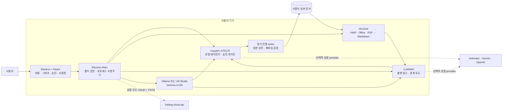

<p align="center">
  
</p>

<p align="center">
  내 컴퓨터 안의 문서를 읽고, 서로 잇고, 근거를 남긴 채 고치는<br>
  로컬 우선 문서 에이전트
</p>

<p align="center">
  <code>Electron · React · TypeScript</code>&nbsp;&nbsp;
  <code>FastAPI · Python</code>&nbsp;&nbsp;
  <code>Gemma 4 · Ollama · LM Studio</code>&nbsp;&nbsp;
  <code>HWP · DOCX · XLSX · PPTX · PDF</code>
</p>

---

## Folding

업무 문서는 형식도 폴더도 제각각이라, 필요한 내용을 찾는 것도 찾은 내용을 다시 문서에 반영하는
것도 매번 끊깁니다. Folding은 사용자가 고른 로컬 폴더를 하나의 지식 버전으로 정리해 자연어로
묻고, 답의 근거를 원문에서 확인하고, 같은 대화 안에서 문서를 고칠 수 있게 합니다.

기본값은 **완전한 로컬 실행**입니다. API 키·로그인·구독 없이 변환·분석·질의·조립·편집이
사용자 PC에서 돌고, Gemma 4는 Ollama 또는 LM Studio의 OpenAI 호환 loopback API로 호출됩니다.
상용화할 때만 같은 provider 경계에 Anthropic·Gemini·OpenAI API를 명시적으로 연결합니다.

에이전트는 도구를 가리지 않습니다. 대신 **모든 도구 사용이 승인 게이트를 지납니다.** 무엇을
하려는지, 얼마나 위험한지, 원래 시킨 일이 무엇이었는지를 보여 주고 사람이 정합니다.

## 시연

`<TBD>`

## 지식 그래프


<p align="center">
  실제 화면 — 문서 119개와 관계 285개, 서로 이어진 덩어리별로 색이 다르다
</p>

그래프의 색은 장식이 아니라 **네트워크**입니다. 서로 링크로 이어진 덩어리를 하나로 보고 색을
주며, 이름은 사람이 붙이지 않고 구성원이 가장 많이 들어 있는 폴더에서 뽑습니다. 위 화면에서는
119개 문서가 네트워크 11개와 어디에도 이어지지 않은 문서 29개로 갈렸습니다. 우측 문서 트리의
색점도 같은 계산을 쓰므로, 같은 뭉치는 두 화면에서 언제나 같은 색입니다.

### 관계는 어떻게 생기나

변환된 실제 문서(hwp·docx·pdf)는 서로를 마크다운 링크로 가리키지 않습니다. 명시적 링크만
세면 그래프에 점만 남습니다. 그래서 **문서마다 뽑아 둔 엔티티가 겹치는지**로 관계를 유도합니다.

| 단계 | 하는 일 |
| --- | --- |
| 흔한 것 제외 | 거의 모든 문서에 나오는 엔티티는 판별력이 없습니다. 전부를 전부에 잇는 것을 막습니다. |
| 문서당 상한 | 각 문서는 가장 강하게 겹치는 몇 개까지만 잇습니다. |
| 근거 보존 | 겹친 엔티티 전부와, **양쪽 문서가 각각 그것을 말한 문장**을 함께 남깁니다. |

문서를 고르면 아래 정보줄이 연결 목록으로 펼쳐집니다. 이웃마다 무엇을 함께 언급했는지 칩으로
보이고, 펼치면 양쪽 문장이 나란히 나옵니다. 한쪽만 보이면 "이 문서가 저 문서를 가리킨다"로
읽히는데, 엔티티 겹침에는 방향이 없기 때문입니다. 네트워크 이름을 누르면 **무엇이 이 뭉치를
묶었는지**가 많이 나온 순으로 나옵니다 — 사람 이름만 잔뜩이라면 그 자체가 알아야 할 사실입니다.

## 문서를 고칠 때

에이전트에게 도구를 제한하지 않습니다. 다만 **형식 전용 편집 도구를 쓰도록 유도**합니다. 범용
편집기로 hwp·docx를 직접 만지면 서식이 뭉개지기 때문입니다.

| 형식 | 도구 | 방식 |
| --- | --- | --- |
| HWP | rhwp (Rust·WASM) | 표 칸 인덱스로 값을 넣고 `.hwp` 로 그대로 내보냅니다 |
| DOCX · XLSX · PPTX | python-docx · openpyxl · python-pptx | 문단·표 칸·도형을 찾아 바꿉니다. 수식은 건드리지 않습니다 |
| PDF | pymupdf | 본문은 안전하게 못 바꿉니다. **고치는 척하지 않고** 주석 사본을 만듭니다 |

세 가지를 계약으로 못 박았습니다.

- **원본을 덮어쓰지 않습니다.** 결과는 언제나 새 파일입니다.
- **저장한 뒤 다시 열어 확인합니다.** 바뀐 내용이 실제로 들어갔는지 재파싱으로 검증합니다.
- **못 바꿨으면 결과 파일을 남기지 않습니다.** 반쪽짜리 사본을 완성본인 척 남기는 것이 가장
  나쁘기 때문입니다.

## 승인 게이트

도구를 가리지 않는 대신, 도구가 실행되기 전에 사람이 봅니다.

| 등급 | 무엇이 | 어떻게 |
| --- | --- | --- |
| SAFE | 읽기·검색 | 자동 허용 — 되돌릴 것이 없고, 매번 물으면 승인 피로만 쌓입니다 |
| CAUTION | 파일을 쓰거나 고침 | 승인을 받습니다. 되돌릴 수 있습니다 |
| DANGER | 되돌릴 수 없거나 밖으로 나감 | 이유를 함께 보여 줍니다 (`rm` · 강제 푸시 · 외부 요청 …) |

승인 창은 **사용자가 원래 시킨 일**을 함께 보여 줍니다. 프롬프트 인젝션은 자동으로 가려낼 수
없지만, 요약을 시켰는데 `rm` 이 뜨면 사람은 알아봅니다. 답이 없으면 **거부**로 처리합니다 —
보지도 못한 채 실행되면 안 되기 때문입니다.

## 크레딧

크레딧과 과금 한도는 **상용 API 모드에만** 적용됩니다. 로컬 Gemma 4 모드에는 외부 호출 비용이
없으므로 대화·문서 분석을 크레딧으로 막지 않습니다. 상용 모드에서 사용자에게는 토큰도 원화도
보이지 않습니다. 토큰은 사용자의 언어가 아니고, 원화를 그대로
띄우면 모델 단가가 바뀔 때마다 같은 금액이 조용히 다른 양이 됩니다.

```
대화 1건        = 1 크레딧
문서 20개 분석  = 1 크레딧
```

지갑은 둘입니다. 하나로 두면 폴더를 크게 등록한 날 대화를 한 번도 못 하게 됩니다. **문서를
분석하기 전에** 이번에 분석할 문서 수와 드는 크레딧을 보여 주고 확인받습니다 — 시작한 뒤에
알려주면 크레딧은 이미 나가 있습니다. 이미 분석한 문서는 내용이 바뀌지 않는 한 다시 부르지
않으므로 그 수는 빼고 셉니다.

## 아키텍처



로그인은 **누구인가**를 확인하고, 폴더 선택은 **어느 파일을 다룰 수 있는가**를 정합니다.
로그인만으로 파일 권한이 생기지 않습니다.

## 구현 구성

| 모듈 | 역할 | 온 곳 |
| --- | --- | --- |
| [`apps/desktop`](apps/desktop) | Electron 앱, 3분할 UI, 승인 모달, 사용량, 사이드카 감독 | `codegate-2026-local` |
| [`services/agent`](services/agent) | 로컬 Gemma 4/선택적 Claude 에이전트, 승인 게이트, 형식 전용 writer | `codegate-2026-agent` |
| [`services/convert`](services/convert) | doc2md — 원본을 마크다운으로 | `codegate-2026-convert` (민규) |
| [`packages/llmwiki`](packages/llmwiki) | 위키 빌더 — 불변 빌드, 관계 유도, 근거 보존 | `codegate-2026-backend` (용휘·성주) |

각 폴더는 원래 저장소의 커밋 기록을 그대로 가지고 들어왔습니다(`git subtree`). `git log` 에
네 사람의 이름이 남아 있습니다. 기존 저장소는 지우지 않았습니다.

OAuth·세션·구독 서버는 [`folding-cloud-api`](https://github.com/dotenv-uploaded/folding-cloud-api)
로 갈랐습니다. 이것만 사용자 PC가 아니라 **서버에 배포**되고, 로컬에 절대 내려가지 않는 비밀을
쥐며, 그 자체가 네트워크 경계이기 때문입니다.

## 실행

### 준비 사항

- Windows 10 22H2 이상, macOS 14 이상, 또는 glibc 2.35 이상 Linux
- 개발 실행: Node.js 22, pnpm 11, [uv](https://docs.astral.sh/uv/)
- 로컬 모델: 설치본에 포함된 Ollama 또는 이미 실행 중인 Ollama/LM Studio
- API 키: **필요 없음**

```bash
git clone https://github.com/dotenv-uploaded/folding.git
cd folding
```

```shell
cd services/agent
uv sync --group dev
cd ../../services/convert/services/doc2md
uv sync --extra test
cd ../../../../apps/desktop
pnpm install --frozen-lockfile
pnpm dev:integrated
```

두 Python 모듈은 각자의 `.venv`만 사용합니다. 최초 로컬 실행에는 Ollama 또는 LM Studio에서
`gemma4:e2b`를 준비합니다. 설치본은 내장 Ollama를 시작하고 모델이 없으면 최초 한 번 약 7.2 GB를
다운로드합니다.

```shell
# PyInstaller 사이드카까지 포함한 로컬 전체 계약
cd apps/desktop
pnpm runtime:python
pnpm runtime:prerequisites
pnpm runtime:smoke

# 현재 OS용 설치 파일 1개
pnpm package
```

운영체제 하나가 다른 운영체제의 실행 형식을 직접 실행할 수는 없으므로 산출물은 OS별 한 개입니다.

| OS | 산출물 |
| --- | --- |
| Windows x64 | `Folding-<version>-win-x64.exe` |
| macOS arm64/x64 | `Folding-<version>-mac-<arch>.dmg` |
| Linux arm64/x64 | `Folding-<version>-linux-<arch>.AppImage` |

Windows 설치 파일은 Microsoft 서명과 SHA-256을 검증한 VC++ Runtime을 포함하고, 설치된 버전이
낮을 때만 갱신합니다. 모든 OS에서 첫 실행 전에 OS·architecture·메모리·디스크·GPU·동봉 native
파일을 검사하며 결과는 `runtime-diagnostics.json`에 남습니다. DirectX와 Metal은 OS 구성 요소이고
GPU 드라이버는 제조사/배포판 구성 요소이므로 임의 DLL을 덮어쓰지 않고, 기준 미달 시 진단과
CPU 폴백을 사용합니다.

사용자 문서, 모델 파일, OAuth 세션, API 키, 로컬 지식 인덱스는 Git과 설치 파일에 포함되지
않습니다. 상용 API 전환은 `CODEGATE_LLM_PROVIDER`와 `CODEGATE_AGENT_MODE`를 명시적으로 바꿀
때만 일어납니다.

## 더 보기

- [Discord LLMWiki architecture](docs/DISCORD_LLMWIKI.md)
- [통합 아키텍처와 시작 순서](docs/ARCHITECTURE.md)
- [로컬 테스트와 설치 파일](docs/LOCAL_TEST_INSTALLER.md)
- [남은 이관 배선](docs/MIGRATION.md)
- [쓰기 도구 설계](services/agent/docs/WRITE_TOOLS_DESIGN.md)
- [프런트엔드 명세](apps/desktop/docs/FRONTEND_SPEC.md)
- [기획 개요](apps/desktop/docs/기획안/README.md)
- [트러블슈팅](apps/desktop/docs/TROUBLESHOOTING.md)
