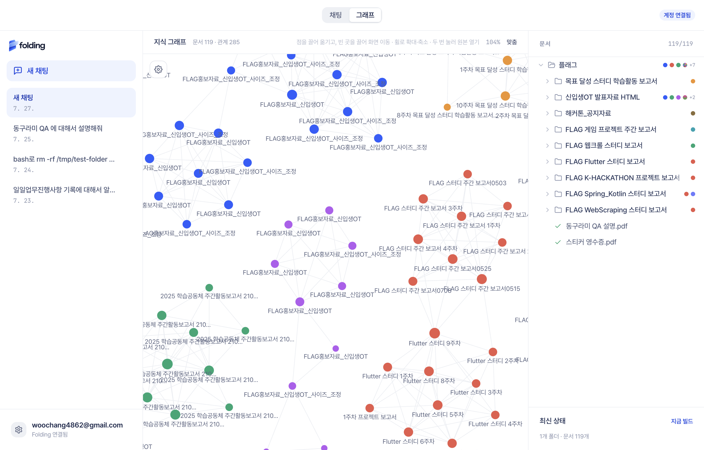
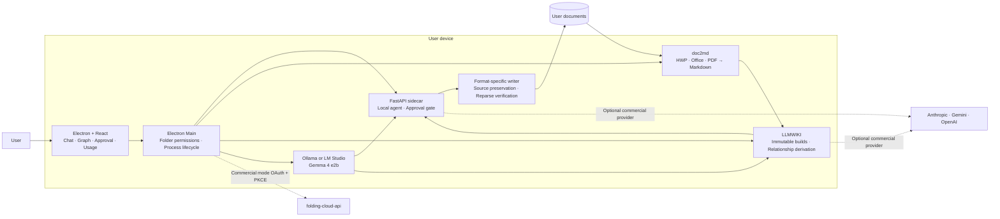

<p align="center">
  
</p>

<p align="center">
  A local-first document agent that reads, connects, and safely edits files<br>
  while preserving evidence from the original documents
</p>

<p align="center">
  <code>Electron · React · TypeScript</code>&nbsp;&nbsp;
  <code>FastAPI · Python</code>&nbsp;&nbsp;
  <code>Gemma 4 · Ollama · LM Studio</code>&nbsp;&nbsp;
  <code>HWP · DOCX · XLSX · PPTX · PDF</code>
</p>

---

## Folding

Business documents are scattered across different formats and folders. Finding the right information and applying
it back to a document often requires several disconnected tools. Folding organizes user-selected local folders into
a versioned knowledge base so users can ask questions in natural language, inspect evidence from the source files,
and edit documents within the same conversation.

The default mode is **fully local**. Conversion, analysis, retrieval, assembly, and editing run on the user's
computer without a third-party AI API key. The current local build supports only `gemma4:e2b`, accessed through the
OpenAI-compatible loopback API exposed by Ollama or LM Studio. This describes the inference path, not the product
license: a commercial distribution may still require a Folding account, license, or subscription. Cloud AI
providers remain a separate future commercial boundary and are not selected by the local settings interface.

The agent is not restricted to a small tool list. Instead, **every tool invocation passes through an approval
gate**. The interface shows what the agent intends to do, the associated risk, and the user's original request so
the user remains in control.

## Demo

`<TBD>`

## Knowledge Graph



<p align="center">
  Actual interface — 119 documents and 285 relationships, colored by connected network
</p>

Graph colors represent **networks**, not decoration. Documents connected through relationships form a network and
receive the same color. Network names are derived from the folder that contains the largest number of member
documents rather than being assigned manually. In the example above, 119 documents form 11 networks, with 29
documents remaining unconnected. The document tree uses the same color calculation, so a network is represented
consistently in both views.

### How relationships are created

Converted source documents such as HWP, DOCX, and PDF files do not normally contain Markdown links to one another.
Counting explicit links alone would leave the graph as a collection of isolated nodes. Folding therefore derives
relationships from **entities shared by multiple documents**.

| Stage | Behavior |
| --- | --- |
| Remove common entities | Entities that occur in nearly every document have little discriminating value and would connect everything to everything. |
| Limit neighbors | Each document is linked only to a limited number of documents with the strongest entity overlap. |
| Preserve evidence | Every shared entity is stored together with the sentence in which **each source document mentions it**. |

Selecting a document expands the information bar into a list of connected documents. Entity chips explain what
each pair shares, and expanding a relationship displays the supporting sentences side by side. Showing both sides
is important because entity overlap is not directional. Selecting a network name lists the entities that bind the
network together, ordered by frequency. If a network is dominated by personal names, that is itself useful
information.

## Editing Documents

The agent can use general tools, but it is guided toward **format-specific document writers**. Editing HWP or DOCX
files with a generic text editor can destroy layout and formatting.

| Format | Tool | Method |
| --- | --- | --- |
| HWP | rhwp (Rust/WASM) | Writes values by table-cell index and exports a new `.hwp` file. |
| DOCX · XLSX · PPTX | python-docx · openpyxl · python-pptx | Locates and updates paragraphs, table cells, and shapes without modifying formulas. |
| PDF | PyMuPDF | Does not pretend that PDF body text can be edited safely; it produces an annotated copy instead. |

Document writers enforce three rules:

- **Never overwrite the source file.** Every result is written to a new file.
- **Reopen and verify the saved file.** The result is reparsed to confirm that the requested changes are present.
- **Do not leave partial output behind.** A failed edit must not produce a file that appears complete.

## Approval Gate

The agent can use any available tool, but a human reviews actions before execution.

| Level | Action | Policy |
| --- | --- | --- |
| SAFE | Read and search | Allowed automatically because there is nothing to undo and repeated prompts would create approval fatigue. |
| CAUTION | Create or modify files | Requires approval because the action changes local state but can be reversed. |
| DANGER | Irreversible or external action | Requires approval with an explicit reason, for example `rm`, force push, or an external request. |

The approval dialog also displays **the user's original request**. Prompt injection cannot be detected perfectly,
but a user who requested a summary can recognize that an unexpected `rm` command is unrelated. If the user does
not respond, the request is treated as **denied**.

## Usage Credits

Credits and usage limits apply **only to commercial API mode**. Local Gemma 4 mode has no external inference cost,
so local conversations and document analysis are not restricted by credits. Commercial mode does not expose raw
token counts or model-specific currency estimates to users because model prices can change independently of the
product's user-facing value.

```text
1 conversation          = 1 credit
20 documents analyzed   = 1 credit
```

Conversation and document-analysis credits are tracked separately. A large folder registration should not prevent
the user from starting a conversation. Before analysis begins, Folding displays the number of documents that will
be processed and the required credits. Documents that have already been analyzed are excluded unless their content
has changed.

## Architecture



Authentication determines **who the user is**. Folder selection determines **which files the application may
access**. Signing in does not grant access to local files.

## Repository Layout

| Module | Responsibility | Source project |
| --- | --- | --- |
| [`apps/desktop`](apps/desktop) | Electron application, three-pane UI, approvals, usage display, and sidecar supervision | `codegate-2026-local` |
| [`services/agent`](services/agent) | Local Gemma 4 or optional Claude agent, approval gate, and format-specific writers | `codegate-2026-agent` |
| [`services/convert`](services/convert) | doc2md source-document conversion | `codegate-2026-convert` |
| [`packages/llmwiki`](packages/llmwiki) | Immutable wiki builds, relationship derivation, and evidence preservation | `codegate-2026-backend` |

The modules were imported with their original commit history using `git subtree`. Contributor history remains
available through `git log`, and the original repositories have not been removed.

OAuth, session, and subscription services live in
[`folding-cloud-api`](https://github.com/dotenv-uploaded/folding-cloud-api). This component is deployed to a server
rather than a user device because it holds secrets that must never be distributed locally and forms the network
trust boundary.

## Running Locally

### Prerequisites

- Windows 10 22H2 or later, macOS 14 or later, or Linux with glibc 2.35 or later
- Development only: Node.js 22, pnpm 11, and [uv](https://docs.astral.sh/uv/)
- Local model: the bundled Ollama runtime or an existing Ollama/LM Studio server
- API key: **not required**

```bash
git clone https://github.com/dotenv-uploaded/_FOLDING_.git
cd _FOLDING_
```

```shell
cd services/agent
uv sync --group dev
cd ../../services/convert/services/doc2md
uv sync --extra test
cd ../../../../apps/desktop
pnpm install --frozen-lockfile
pnpm dev:integrated
```

Each Python module uses its own `.venv`. For a local development run, prepare `gemma4:e2b` in Ollama or LM
Studio. The packaged application starts its bundled Ollama runtime and downloads approximately 7.2 GB once if the
model is not already available.

```shell
# Validate the complete local runtime, including PyInstaller sidecars
cd apps/desktop
pnpm runtime:python
pnpm runtime:prerequisites
pnpm runtime:smoke

# Build one installer for the current operating system
pnpm package
```

An operating system cannot execute another operating system's native binary format, so Folding produces one
self-contained artifact for each supported OS and architecture.

| OS | Artifact |
| --- | --- |
| Windows x64 | `Folding-<version>-win-x64.exe` |
| macOS arm64/x64 | `Folding-<version>-mac-<arch>.dmg` |
| Linux arm64/x64 | `Folding-<version>-linux-<arch>.AppImage` |

### Installation by Operating System

Download the single artifact matching your operating system and architecture from GitHub Releases or the
`Desktop installers` CI artifacts. If an official release provides a SHA-256 checksum, compare it with the
downloaded file before installation. On first launch, Folding looks for `gemma4:e2b` in an existing Ollama or LM
Studio instance. If it is not available, the bundled Ollama runtime downloads the model once, so an internet
connection and sufficient model storage are required.

#### Windows 10/11 x64

1. Run `Folding-<version>-win-x64.exe`.
2. Approve the UAC request and use the default installation directory. If you choose a custom location, use a
   short path such as `C:\Apps\Folding`.
3. The installer verifies Windows 10 22H2 build 19045 or later. It updates Microsoft Visual C++ Runtime only when
   the installed version is below the required baseline.
4. Launch **Folding** from the Start menu. If the Visual C++ installer requests a restart, restart Windows before
   launching Folding.

```powershell
Get-FileHash .\Folding-<version>-win-x64.exe -Algorithm SHA256
```

If an unsigned development build is blocked by SmartScreen or Smart App Control, do not disable Windows security.
Use a release that provides an official checksum and code signature. If setup reports that it could not remove old
application files, close Folding completely and rerun the installer. Restart Windows and try again if the files
remain locked.

#### macOS 14 or later

1. Download the `arm64` DMG for Apple Silicon or the `x64` DMG for an Intel Mac. Run `uname -m` to check the
   architecture.
2. Open `Folding-<version>-mac-<arch>.dmg` and drag **Folding** into the `Applications` folder.
3. Launch Folding from `Applications` and approve the first-launch confirmation.

```bash
shasum -a 256 Folding-<version>-mac-<arch>.dmg
```

Production DMGs must be signed with a Developer ID certificate and notarized by Apple. Use an unsigned internal
build only after verifying its source and checksum. After attempting to open it once, use **System Settings →
Privacy & Security → Open Anyway**. Folding does not require disabling Gatekeeper or removing quarantine
attributes globally.

#### Linux with glibc 2.35 or later

1. Download the `x64` AppImage when `uname -m` reports `x86_64`, or the `arm64` AppImage when it reports
   `aarch64`.
2. Grant execute permission and run the AppImage directly. A system-wide installation and separate Python or Node
   installation are not required.

```bash
sha256sum Folding-<version>-linux-<arch>.AppImage
chmod +x Folding-<version>-linux-<arch>.AppImage
./Folding-<version>-linux-<arch>.AppImage
```

If the distribution does not provide FUSE 2 and cannot mount the AppImage, use the following fallback without
forcing a system package change. This mode is slower because it extracts the application to a temporary directory
on every launch.

```bash
./Folding-<version>-linux-<arch>.AppImage --appimage-extract-and-run
```

The Windows installer includes a Visual C++ Runtime package whose Microsoft signature and SHA-256 checksum are
verified during the build. It runs only when an update is required. Before the interface opens, every platform
checks the OS, architecture, memory, disk space, GPU availability, and bundled native files. Results are written to
`runtime-diagnostics.json`.

DirectX and Metal are operating-system components, while GPU drivers are supplied by hardware vendors or Linux
distributions. Folding does not overwrite arbitrary system DLLs or drivers. When acceleration requirements are not
met, diagnostics explain the limitation. Bundled Ollama defaults Gemma 4 to CPU execution on every operating system
so laptops with low-memory GPUs do not fail during model startup. Advanced users can opt into a supported GPU
backend by explicitly setting `OLLAMA_LLM_LIBRARY`.

If a Windows user profile or installation path contains characters that the native Ollama model loader cannot read,
set `CODEGATE_OLLAMA_MODELS_DIR` to an absolute ASCII-only directory such as `C:\FoldingModels`. The application uses
that directory for bundled Ollama model storage without changing user document locations.

User documents, model files, OAuth sessions, API keys, and local knowledge indexes are not stored in Git or bundled
inside installers. Commercial API mode is enabled only when `CODEGATE_LLM_PROVIDER` and `CODEGATE_AGENT_MODE` are
explicitly changed.

## Further Reading

- [Code-signing setup](docs/CODE_SIGNING.md)
- [Discord LLMWiki architecture](docs/DISCORD_LLMWIKI.md)
- [Integrated architecture and startup order](docs/ARCHITECTURE.md)
- [Local testing and installer builds](docs/LOCAL_TEST_INSTALLER.md)
- [Remaining migration wiring](docs/MIGRATION.md)
- [Document writer design](services/agent/docs/WRITE_TOOLS_DESIGN.md)
- [Frontend specification](apps/desktop/docs/FRONTEND_SPEC.md)
- [Product overview](apps/desktop/docs/%EA%B8%B0%ED%9A%8D%EC%95%88/README.md)
- [Troubleshooting](apps/desktop/docs/TROUBLESHOOTING.md)
