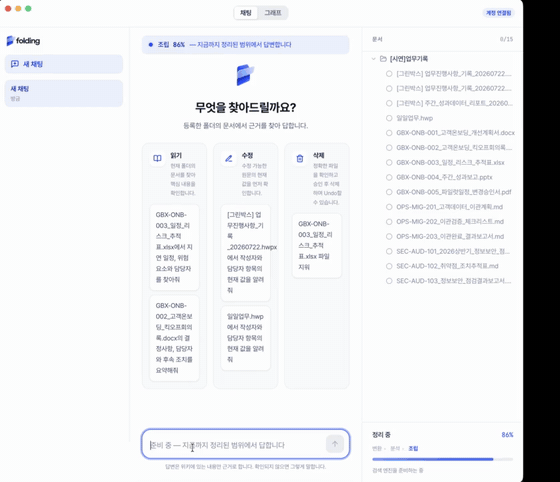
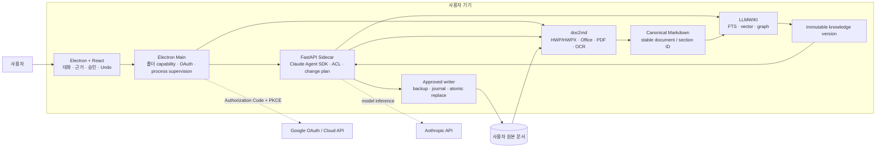

<p align="center">
  
</p>

<p align="center">
  로컬 업무 문서를 근거가 남는 지식으로 연결하고,<br>
  검색부터 승인형 변경·복구까지 이어 주는 데스크톱 문서 에이전트
</p>

<p align="center">
  <code>Electron · React · TypeScript</code>&nbsp;&nbsp;
  <code>FastAPI · Python</code>&nbsp;&nbsp;
  <code>Claude Agent SDK</code>&nbsp;&nbsp;
  <code>HWP/HWPX</code>
</p>

---

## Folding

업무 문서는 형식과 폴더가 제각각이고, 필요한 내용을 찾은 뒤 다시 문서에 반영하는 과정은
쉽게 끊깁니다. Folding은 사용자가 선택한 로컬 폴더를 정규화된 지식 버전으로 구성해 자연어로
탐색하고, 원문 근거를 확인하며, 지원되는 문서는 같은 대화 안에서 수정·삭제·생성할 수 있게 합니다.

에이전트의 판단과 파일시스템 권한은 분리되어 있습니다. 모델은 원본 파일을 직접 다루지 않으며,
모든 변경은 화면에 표시된 diff의 정확한 `plan_hash`를 사용자가 승인한 뒤 결정적인 실행 경로를
통해서만 적용됩니다.

## 시연



<p align="center">
  <a href="https://github.com/dotenv-uploaded/ghdtjdwn_complete/blob/main/docs/demo/folding-final-demo.mp4?raw=1">
    고화질 MP4로 보기
  </a>
</p>

시연에서는 로그인과 폴더 등록부터 문서 질의, 근거 확인, HWP 작성자 변경 승인, 여러 업무 문서를
바탕으로 한 주간업무보고서 HWPX 생성까지 하나의 흐름으로 확인할 수 있습니다.

## 문서 작업의 한 흐름

| 탐색 | 변경 | 생성 |
| --- | --- | --- |
| 질문과 관련된 문서를 에이전트가 검색하고 현재 turn에서 원문을 검증합니다. | 대상·원본 hash·exact diff를 결박한 변경 계획을 만들고 사용자 승인을 기다립니다. | 여러 근거 문서를 검색해 초안을 구성하고 새 HWPX 전체 diff를 먼저 보여 줍니다. |
| 답변의 사실 문장은 문서 ID, revision, section이 포함된 canonical quote로 돌아갑니다. | 승인 후 backup, journal, atomic replace, 지식 버전 게시를 수행하며 Undo가 가능합니다. | 승인 후 Kordoc으로 생성·재파싱하고 기존 파일을 덮어쓰지 않는 방식으로 게시합니다. |

읽기는 HWP/HWPX, PDF, DOCX, XLSX, PPT/PPTX, CSV, HTML, Markdown, TXT를 정규화합니다.
원본 변경은 검증 가능한 writer가 있는 Markdown/TXT와 로컬 Kordoc attestation을 통과한
HWP/HWPX에만 열리며, 그 밖의 형식은 읽기 전용으로 유지됩니다.

## 설계에서 지키는 것

### 근거와 추론을 분리합니다

검색용 보강 정보는 후보를 넓히는 데만 사용합니다. 사용자에게 제시하는 근거는 보존된 원문에서
정확히 찾을 수 있는 quote여야 하며 `document_id`, `revision`, `graph_version`, `chunk_id`,
`section_id`로 다시 추적할 수 있습니다. 한 요청은 하나의 지식 snapshot에 고정되어 서로 다른
버전의 근거가 섞이지 않습니다.

### 승인은 실제 파일 변경의 경계입니다

```text
요청 → 대상·권한·원본 SHA 확인 → exact diff + plan_hash
     → 사용자 승인 → SHA 재확인 → immutable backup + durable journal
     → atomic replace → 문서 재변환 → 새 지식 버전 공개
```

승인 전 원본 write는 0건입니다. 실행 직전 ACL과 원본 SHA-256을 다시 확인하며, 파일과 SQLite가
하나의 transaction이 될 수 없는 경계는 journal과 재시작 복구 절차로 다룹니다. Undo 역시 현재
파일 hash가 앞선 실행 결과와 일치할 때만 backup을 새 실행으로 복원합니다.

### 게시 중인 지식은 항상 완성된 버전입니다

변경된 입력은 staging에서 변환되고 FTS·vector·graph artifact 검증을 거칩니다. 검증이 끝난
`build-<hash>`만 불변 버전으로 설치하며, `current.json` 포인터는 compare-and-swap 방식으로
교체됩니다. 새 빌드가 실패해도 읽기 요청은 직전 정상 버전을 계속 사용합니다.

## 아키텍처



클라우드 로그인은 사용자 신원을 확인하지만 로컬 파일 권한을 만들지 않습니다. 파일 capability는
OS 폴더 선택으로 별도 획득하고, cloud API client와 loopback sidecar client를 분리해 cloud bearer가
로컬 서비스로 전달되지 않게 합니다. Anthropic key, 사용자 문서, 절대 경로, 세션 상태는 renderer와
저장소에 두지 않습니다.

## 구현 구성

| 모듈 | 역할 | 주요 경계 |
| --- | --- | --- |
| [`codegate-2026-web`](codegate-2026-web) | Electron 데스크톱 앱, React UI, OAuth, 폴더 동기화 | diff 승인 UI, sidecar 수명주기, 최소 환경 전달 |
| [`Backend`](Backend) | FastAPI sidecar와 Claude Agent SDK | typed decision, ACL, change plan, 실행·복구·Undo |
| [`codegate-2026-api`](codegate-2026-api) | doc2md 문서 변환 서비스 | 형식별 변환, OCR, 구조 정규화, resource limit |
| [`LLMWIKI`](LLMWIKI) | 지식 패키지와 검색 인덱스 빌더 | stable ID, canonical evidence, immutable build publish |

각 모듈은 adapter와 명시적인 artifact 계약으로 연결됩니다. 에이전트에는 app-owned read tool만
노출하고 범용 `Read/Edit/Write/Bash` 권한은 주지 않습니다. HWP/HWPX writer는 고정된 Kordoc
dependency graph의 digest를 확인하고, patch 결과를 다시 parse해 요청 결과와 일치할 때만 원본을
교체합니다.

## 검증

현재 monorepo를 기준으로 다음 검증을 통과했습니다.

| 범위 | 결과 |
| --- | --- |
| Electron / React | Vitest 159개 통과, 환경 의존 integration 1개 skip |
| doc2md | Pytest 117개 통과 |
| XLSX 안전 정규화 | 집중 테스트 8개 통과 |
| 통합 launcher | 집중 테스트 3개 통과 |
| 정적 검증 | TypeScript typecheck, Node 구문 검사 통과 |
| 공개 트리 | gitleaks finding 0건 |

XLSX는 request-local copy만 정규화해 원본 bytes를 보존하며 ZIP/XML resource abuse와 외부
relationship을 거부합니다. Electron은 child process 종료를 추적하고 sidecar에 필요한 최소 환경만
전달합니다. 실패 원인과 복구 과정은 회귀 테스트와
[`TROUBLESHOOTING.md`](Backend/docs/TROUBLESHOOTING.md)에 함께 기록합니다.

## 실행

### 준비 사항

- macOS 또는 Linux
- Node.js 18 이상
- [uv](https://docs.astral.sh/uv/)
- Anthropic API key

```bash
git clone https://github.com/dotenv-uploaded/ghdtjdwn_complete.git
cd ghdtjdwn_complete
./scripts/bootstrap.sh
```

bootstrap은 pnpm과 uv lockfile에 고정된 Electron, Backend, doc2md 의존성을 설치하고
`codegate-2026-web/.env`를 준비합니다. 생성된 파일에 API key를 입력합니다.

```dotenv
CODEGATE_ANTHROPIC_API_KEY=your-key
```

```bash
./scripts/run-app.sh
```

실행 스크립트는 실제 Google OAuth, 고정 loopback callback
`http://127.0.0.1:47821/auth/callback`, Claude Sonnet, 통합 doc2md를 사용합니다. 새 컴퓨터에서는
Google 로그인을 다시 하고 사용할 문서 폴더를 직접 선택해야 합니다.

API key, OAuth 세션, 사용자 문서, 로컬 지식 인덱스는 Git에 포함되지 않습니다.

## 더 읽기

- [통합 계약](Backend/docs/INTEGRATION_CONTRACT.md)
- [로컬 런타임](Backend/docs/LOCAL_RUNTIME.md)
- [아키텍처 결정 기록](Backend/docs/adr)
- [Frontend 명세](codegate-2026-web/docs/FRONTEND_SPEC.md)
- [작업 기록](codegate-2026-web/docs/WORK_LOG.md)
- [문서 변환기 설계](codegate-2026-api/services/doc2md/README.md)
