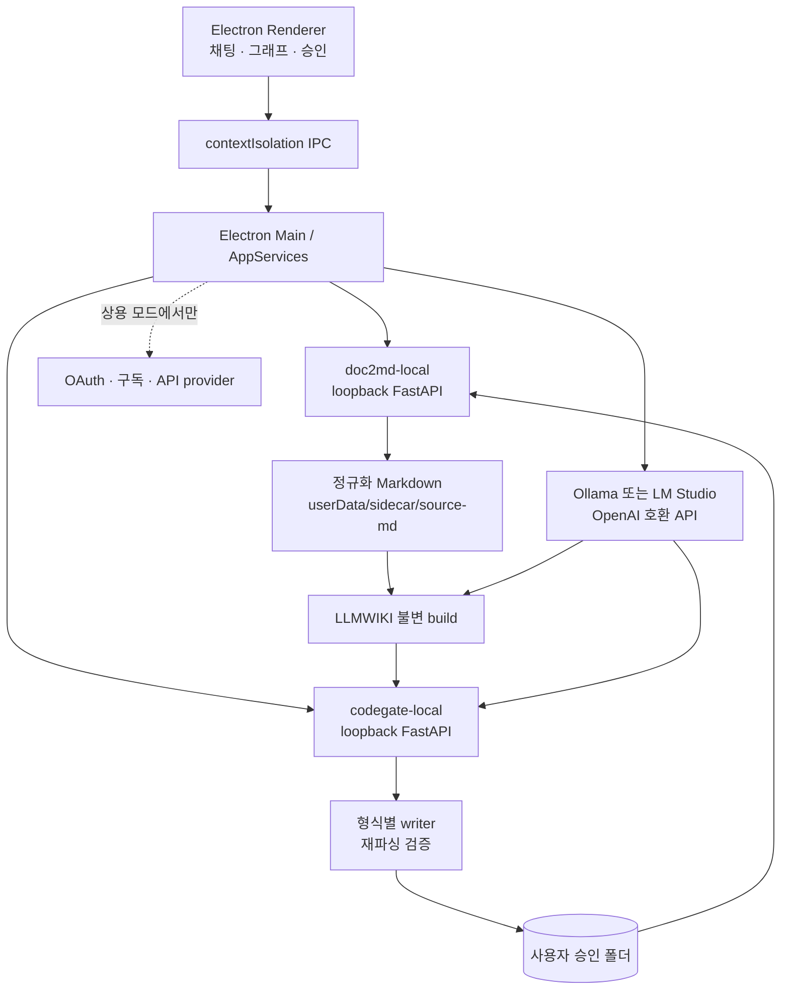
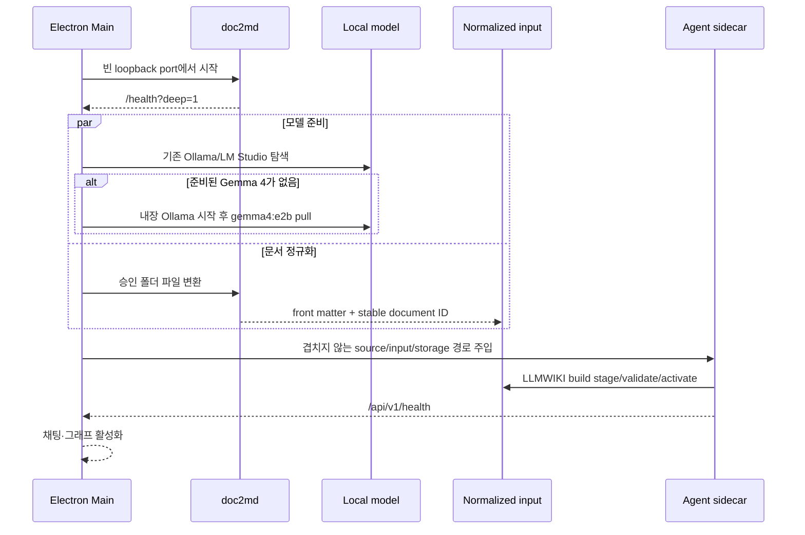
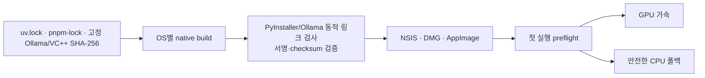

# Folding 통합 아키텍처

이 문서는 현재 코드의 실제 의존성과 실행 순서를 기준으로 작성한 운영 계약이다. 기본 배포는
API 키가 없는 로컬 테스트 모드이고, 상용 API는 동일한 provider 경계 뒤에 선택적으로 연결한다.

## 설계 원칙

1. 사용자 폴더 권한과 프로세스 수명주기는 Electron Main만 소유한다.
2. 외부에서 접근할 수 있는 포트는 열지 않고 모든 내부 서비스는 loopback에만 bind한다.
3. 원본 문서는 `doc2md`가 정규화하고 LLMWIKI는 불변 build를 생성한다.
4. agent는 활성 build만 읽고, 파일 변경은 exact diff 승인과 source hash 검증을 거친다.
5. 로컬 모델과 상용 API는 같은 OpenAI 호환/provider 인터페이스 뒤에 둔다.
6. 증거 본문은 줄임말로 훼손하지 않는다. 토큰 절감은 검색·chunking·캐시로 수행한다.
7. native 의존성은 빌드 시 고정·검증하고, 설치 시 주입하며, 실행 직전 다시 진단한다.

## 프로세스 구조

`codegate-local`에는 agent와 LLMWIKI 호환 adapter가 함께 묶인다. LLMWIKI 소스는 설치 자원으로
포함되고 agent의 내장 Python 런타임에서 import되므로 사용자 PC에 Python 설치가 필요하지 않다.
`doc2md-local`은 별도 PyInstaller 프로세스이며 문서 변환 실패가 agent를 같이 종료시키지 않는다.

## 시작 순서

모델 다운로드와 문서 정규화는 서로 의존하지 않으므로 병렬로 진행할 수 있다. sidecar는 정규화
입력과 모델 endpoint가 준비된 다음 시작한다. 앱 종료 시 Electron Main이 세 프로세스를 역순으로
종료한다.

## Provider 경계

| 모드 | Agent | Enrichment | 인증·과금 |
| --- | --- | --- | --- |
| 로컬 기본 | Gemma 4 via Ollama/LM Studio | 같은 OpenAI 호환 endpoint | 없음, 크레딧 차단 없음 |
| 결정적 테스트 | 규칙 기반 응답 | 비활성 또는 캐시 | 없음 |
| 상용 | Claude Agent SDK 또는 상용 provider | Anthropic/Gemini/OpenAI | OAuth·구독·크레딧 적용 |

로컬 기본값은 `CODEGATE_AGENT_MODE=local`, `CODEGATE_LLM_PROVIDER=local`,
`CODEGATE_LOCAL_LLM_MODEL=gemma4:e2b`다. 상용 전환은 배포 설정이 명시적으로 provider를
선택해야 하며, 로컬 모드가 API 키를 자동 탐색해 외부로 보내지 않는다.

## 토큰과 컨텍스트

LLM끼리 임의의 줄임말 사전을 공유하면 모델 버전·세션이 바뀔 때 뜻이 흔들리고 citation 감사도
불가능해진다. Folding은 원문 근거를 그대로 보존하고 다음 단계에서 토큰을 줄인다.

- 문서 전체 대신 질의와 관련된 상위 chunk만 주입한다.
- normalized input과 enrichment를 source SHA-256으로 캐시한다.
- 긴 문서는 semantic section/source fragment 단위로 분리한다.
- 응답에는 검증 가능한 `document_id`, `revision`, `chunk_id`, `section_id`를 남긴다.
- Discord도 전체 history를 매번 붙이지 않고 동일한 retrieval 경로를 사용한다.

Discord 100,000 tokens 중 500-token 근거 5개만 검색하는 예시는 요청당 2,500 tokens로,
prompt 기준 약 97.5% 절감이다. 이는 corpus와 질의에 따라 달라지는 예시이며 실측식과 제한은
[`DISCORD_LLMWIKI.md`](DISCORD_LLMWIKI.md)에 있다.

## 패키징 경계

| 자원 | 설치 파일 포함 | 첫 실행/사용자 데이터 |
| --- | --- | --- |
| Electron/React/Node 모듈 | 예 | 아니오 |
| `codegate-local` Python 런타임 | 예 | 상태 DB만 userData |
| `doc2md-local` Python 런타임 | 예 | 변환 캐시만 userData |
| Ollama 실행 런타임 | 예 | 아니오 |
| Windows VC++ Runtime 14.50.35719 | Windows 설치본 | 설치 시 중앙 배포·필요한 경우 갱신 |
| Gemma 4 model | 아니오 | 최초 1회 다운로드, userData |
| 사용자 문서·LLMWIKI build | 아니오 | 로컬 userData |

모델을 설치 파일에 넣지 않는 이유는 라이선스 동의와 업데이트 경계를 분리하고 설치 파일이
9 GB 이상으로 불어나는 것을 피하기 위해서다. Ollama는 MIT 라이선스지만 Gemma 사용에는
[Gemma Terms](https://ai.google.dev/gemma/terms)가 별도로 적용된다.

## 설치 의존성 계층

- Python은 agent와 doc2md 각각의 `.venv`에서만 동기화한 뒤 PyInstaller로 동결한다. 사용자 PC에는
  Python이나 `uv`가 필요하지 않다.
- Windows 설치본은 Microsoft 서명이 유효하고 SHA-256이 고정된 VC++ Runtime을 포함한다.
  NSIS는 레지스트리의 설치 버전을 비교하고 14.50.35719보다 낮을 때만 `/install /quiet
  /norestart`로 중앙 갱신한다.
- DirectX 12와 macOS Metal은 운영체제 구성 요소이므로 사설 DLL을 덮어쓰지 않는다. 지원 OS
  버전을 강제하고 DirectX·GPU 드라이버를 진단한 뒤 Ollama의 GPU 자동 선택 또는 CPU 폴백을
  사용한다.
- Linux는 Ubuntu 22.04 LTS와 동등한 glibc 2.35를 기준으로 native runner에서 빌드한다. NVIDIA,
  ROCm, Vulkan 드라이버는 커널·배포판 소유이므로 설치본이 강제 교체하지 않고 진단 결과와
  업데이트 방법을 남긴다.
- 진단 결과는 `userData/runtime-diagnostics.json`에 기록한다. OS/architecture, 메모리, 모델
  저장 디스크, VC++, DirectX, GPU, glibc, 동봉 sidecar·Ollama·kordoc·rhwp·SQLite native 파일을
  확인한다.

## 장애 격리

- doc2md 실패: 문서별 진단을 남기며 기존 활성 LLMWIKI build는 유지한다.
- 모델 미준비: 사용자에게 다운로드/LM Studio load 상태를 표시하고 기존 검색 근거는 유지한다.
- build 실패: candidate를 활성화하지 않고 이전 `current.json`을 유지한다.
- 승인 후 원본 변경: before/after/source hash가 다르면 실행하지 않는다.
- Windows CRLF: 승인된 normalized input은 binary atomic write로 기록해 해시 변형을 막는다.
- 프로세스 crash: supervisor가 제한된 backoff로 재시작하며 앱 dispose 후에는 재시작하지 않는다.
- 설치 의존성 누락: UI를 띄우기 전에 오류와 복구 방법을 표시하고 불완전한 런타임으로 진행하지
  않는다. 메모리·디스크·드라이버 부족은 진단 파일에 경고하고 CPU 경로를 유지한다.

## 상용화 확장점

상용화 시 Electron과 문서 파이프라인을 갈아엎지 않는다. provider adapter, OAuth/구독 서버,
사용량 가격표만 활성화한다. 외부 API에 전달되는 컨텍스트 범위, 보존 정책, tenant ACL은 별도
운영 정책과 데이터 처리 계약으로 명시해야 한다.
