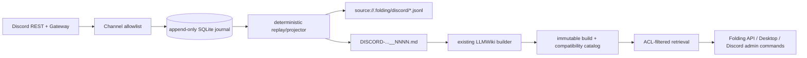

# Discord LLMWiki Architecture

## 목적

Discord 대화를 매 요청마다 모델에 다시 붙이지 않고, Folding의 기존 LLMWiki 빌드와
근거 검색 경로에 연결한다. Discord는 별도 지식 저장소가 아니라 **재생 가능한 외부
소스 어댑터**다. 원문 이벤트는 불변 journal로 보존하고, 검색용 Markdown은 언제든
동일하게 재생성한다.

이 설계는 다음 불변식을 유지한다.

- 모델 입력은 전체 대화가 아니라 ACL을 통과한 검색 근거만 포함한다.
- Discord 본문은 신뢰하지 않는 입력이며 명령이나 링크로 실행하지 않는다.
- Discord 문서는 source-fragment 방식의 read-only 문서다.
- 기존 LLMWiki의 schema, CAS publish, checksum, citation 검증을 우회하지 않는다.
- 채널은 deny-by-default allowlist로 제한한다.
- Gateway 중단 후에도 event journal에서 동일한 결과를 복구한다.

## 구성



구현 위치:

| 역할 | 파일 |
| --- | --- |
| 이벤트 모델, journal, REST backfill, projector | `services/agent/src/codegate_api/integrations/discord_source.py` |
| Gateway와 관리자 slash commands | `services/agent/src/codegate_api/integrations/discord_gateway.py` |
| 운영 API | `services/agent/src/codegate_api/api/discord_source.py` |
| 설정과 수명주기 | `services/agent/src/codegate_api/config.py`, `services/agent/src/codegate_api/container.py` |
| Desktop 비밀값 전달 경계 | `apps/desktop/src/main/sidecar/supervisor.ts` |

## 데이터 흐름

### 1. 과거 메시지 backfill

`POST /api/v1/knowledge/sources/discord/backfill`은 Discord REST API v10에서 허용된
텍스트 채널, 활성 thread, public archived thread를 읽는다. 메시지는 100개 단위로
`before` cursor를 사용해 끝까지 순회한다.

### 2. 실시간 수집

Gateway는 `MESSAGE_CREATE`, `MESSAGE_UPDATE`, `MESSAGE_DELETE`, `THREAD_CREATE`,
`THREAD_UPDATE`만 정규화한다. Bot 자신의 메시지와 다른 guild, allowlist 밖 채널은
journal에 들어가지 않는다. parent channel이 허용된 thread는 허용된다.

### 3. 불변 journal

이벤트는 `.runtime/discord/events.sqlite3`에 append-only로 기록한다. event key에는
Discord message ID와 payload digest가 들어가므로 REST와 Gateway가 같은 이벤트를
전달해도 중복 삽입하지 않는다. update와 delete도 과거 이벤트를 덮어쓰지 않는다.

### 4. 결정적 projection

projector는 sequence 순서로 journal을 재생한다.

- create는 message 상태를 만든다.
- update는 현재 상태를 교체한다.
- delete는 검색 projection에서 제거한다.
- 모든 raw event는 `source_root/.folding/discord/<guild>/<channel>.jsonl`에 남는다.
- 검색 입력은 `llmwiki_input_root/DISCORD-<guild>-<channel>__NNNN.md`로 생성한다.
- ownership manifest에 기록된 파일만 정리하므로 일반 문서를 삭제하지 않는다.
- 동일 입력에 대한 두 번째 projection은 byte change가 없으며 rebuild를 생략할 수 있다.

Discord 본문은 blockquote로 렌더링하고 Markdown link 문법을 중립화한다. 따라서
`[REG-000001](...)` 같은 사용자 입력이 LLMWiki 내부 관계로 오인되지 않는다.

## LLMWiki 통합

동일 채널의 fragment는 같은 문서 ID와 source hash를 공유하고 `chunk_no`만 다르다.
LLMWiki는 이를 `source-fragments` 문서로 병합한다. Compatibility adapter는 이
chunking mode를 자동으로 read-only로 해석한다. Discord 대화에서 생성한 문서를
Folding의 원본 문서 편집 경로로 수정할 수 없다.

Raw JSONL의 SHA-256은 frontmatter의 `source.sha256`과 revision에 반영된다. 따라서
LLMWiki의 source freshness 검증과 citation 생성은 기존 문서와 같은 방식으로 동작한다.

## 조회 표면

API:

| Method | Path | 용도 |
| --- | --- | --- |
| GET | `/api/v1/knowledge/sources/discord/status` | event 수, 문서, build, Gateway 상태 |
| POST | `/api/v1/knowledge/sources/discord/backfill` | REST 과거 수집 + projection + rebuild |
| POST | `/api/v1/knowledge/sources/discord/project` | journal 재생 + 강제 rebuild |
| GET | `/api/v1/knowledge/sources/discord/context?query=...` | 요청자의 ACL로 Discord 근거 검색 |
| GET | `/api/v1/knowledge/sources/discord/export` | projection Markdown 내보내기 |

Discord slash commands는 administrator 권한이 필요하며 응답은 ephemeral이다.

- `/context <query>`: Discord 문서만 근거 검색
- `/summary`: 최근 활동·결정·작업에 대한 retrieval digest
- `/decisions`: 결정 관련 근거 검색
- `/tasks`: action item 관련 근거 검색
- `/export-md`: 현재 projection을 Markdown 파일로 반환

명령은 전체 journal을 모델에 보내지 않는다. `/summary`, `/decisions`, `/tasks`도
생성형 요약이 아니라 기존 LLMWiki 검색 결과를 제한된 크기로 반환한다.

## 토큰 절감

여기서 절감 수단은 LLM끼리 임의의 줄임말을 주고받는 것이 아니다. 근거 본문은 citation
검증과 사람의 감사를 위해 verbatim으로 유지하며, 의미를 바꾸는 abbreviation은 금지한다.
절감은 (1) 전체 history 대신 관련 evidence만 선택하고, (2) 반복 metadata를 host 쪽에
남기는 방식으로 얻는다. 별도의 가역 transport codec을 추가할 경우에도 원문 round-trip과
citation resolution을 먼저 검증해야 한다.

절감량은 대화 길이와 검색 hit 수에 따라 달라지므로 고정 비율을 보장하지 않는다.
예를 들어 Discord 누적 대화가 100,000 tokens이고 질의당 5개 근거 chunk가
각 500 tokens라면:

```text
전체 재전송: 100,000 tokens / request
검색 근거:     2,500 tokens / request
절감:         97.5%
```

실제 운영에서는 query, system prompt, citation metadata가 추가된다. 권장 측정식은
다음과 같다.

```text
savings = 1 - retrieved_prompt_tokens / full_history_prompt_tokens
```

짧은 채널은 절감 폭이 작고, 긴 프로젝트 채널은 일반적으로 60~95% 이상 절감할 수
있다. 이 수치는 설계 범위이며 실제 값은 API usage telemetry로 검증해야 한다.

## 설정

Desktop 또는 agent `.env`에 설정한다.

```dotenv
CODEGATE_DISCORD_ENABLED=true
CODEGATE_DISCORD_BOT_TOKEN=<bot-token>
CODEGATE_DISCORD_GUILD_ID=<guild-snowflake>
CODEGATE_DISCORD_CHANNEL_ALLOWLIST=<channel-id>,<channel-id>
CODEGATE_DISCORD_GATEWAY_ENABLED=true
CODEGATE_DISCORD_REBUILD_DEBOUNCE_SECONDS=5
```

`CODEGATE_DISCORD_CHANNEL_ALLOWLIST=*`는 모든 채널을 의도적으로 허용할 때만 사용한다.
빈 allowlist, 이름 기반 allowlist, `*`와 ID 혼합은 시작 단계에서 거부된다.

Discord Developer Portal에서 bot에 Guilds, Guild Messages, Message Content intent와
과거 메시지를 읽을 권한을 부여해야 한다. slash command는 guild 범위로 동기화한다.

## 보안과 보존

- Bot token은 `SecretStr`이며 API 응답이나 로그에 출력하지 않는다.
- Desktop은 `CODEGATE_DISCORD_*` 이름만 sidecar로 전달한다. 일반
  `DISCORD_BOT_TOKEN`이나 다른 process secret은 전달하지 않는다.
- 현재 구현은 local LLMWiki 전용이다. production에서는 tenant/guild/ACL 매핑이
  정의될 때까지 설정 검증이 시작을 거부한다.
- 삭제 이벤트는 검색 projection에서 본문을 제거하지만 append-only raw journal에는
  과거 create/update가 남는다. 이는 감사·재현성을 위한 의도된 보존 정책이다.
- 법적 삭제가 필요한 배포는 journal 전체를 폐기하고 허용된 원천에서 다시 backfill하는
  별도 운영 절차를 가져야 한다.
- attachment는 메타데이터와 URL만 기록하며 파일을 자동 다운로드하거나 실행하지 않는다.

## 실패와 복구

- Discord REST 429는 `Retry-After`를 존중해 제한적으로 재시도한다.
- Gateway 실패는 status API의 `gateway_error`에 노출된다.
- event 저장 후 rebuild가 실패하면 journal은 남는다. `/project` 재호출로 복구한다.
- projection은 atomic replace와 directory fsync를 사용한다.
- LLMWiki publish 실패는 기존 active build를 유지한다.
- Gateway shutdown은 pending debounce task를 취소한 후 HTTP client를 닫는다.

## 검증

핵심 테스트는 `services/agent/tests/test_discord_source.py`에 있다.

- allowlist와 parent thread
- event idempotency
- create/update/delete replay
- raw journal과 source-fragment frontmatter
- Markdown link 중립화
- ownership-safe cleanup
- REST pagination과 채널 필터
- 설정 불변식과 debounce
